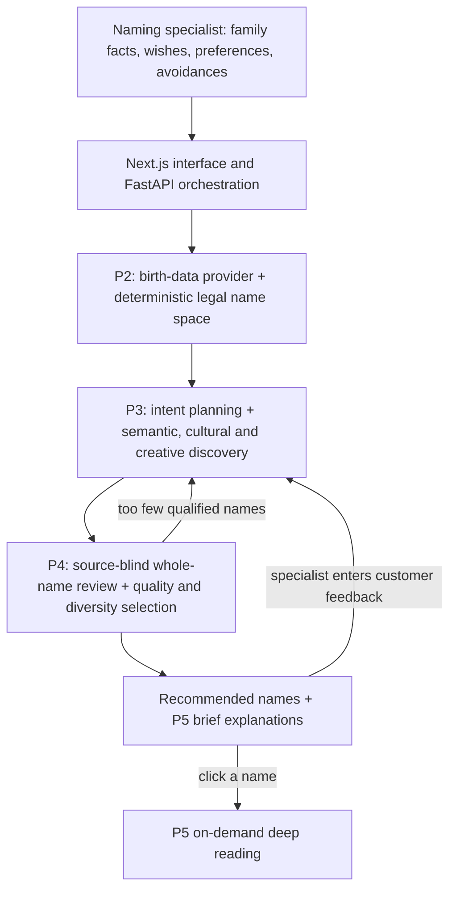

# Chinese Name Generation Agent

**Modernizing a rule-based Chinese naming workflow with retrieval, LLM evaluation, and human review.**

[English](README.md) · [简体中文](README.zh-CN.md)

> This repository is a **project showcase**. The implementation, private customer data, provider credentials, and runnable services are not published here. The system is an internal tool for professional naming specialists; parents do not operate it directly.

## The problem

A naming specialist used to collect a family's requirements, search character meanings and classical literature, and examine many combinations by hand. This takes time, and the result depends heavily on the specialist's literary knowledge and aesthetic judgment. The company's earlier software could apply birth-related rules, five-element preferences, stroke rules, character lists, and avoidance rules consistently. It could not interpret an open-ended wish or judge whether two individually meaningful characters make a natural name together.

The goal of V1 is to **help specialists explore a large legal name space and review promising, personalized full names faster**. It does not replace their final judgment.

## V1 architecture

**P2 establishes what is allowed.** Birth information is obtained through a provider and checked before the deterministic naming rules construct the eligible name space. The LLM cannot change the birth facts, stroke counts, five-element constraints, or avoided characters. Proposed names are checked against the current family's legal pool before admission.

**P3 finds names worth reviewing.** An LLM turns the specialist's account of parental wishes into several search directions. BM25 ranks names by keyword matches against searchable name and character-meaning text. A local BGE embedding model ranks semantic proximity: the two character vectors are composed and compared with the query using cosine similarity. The two name-search lists are interleaved, not added into a single “name quality” score. Other routes search classical poetry, browse the legal pool beyond retrieval's top ranks, and explore new combinations. All routes are deduplicated and rechecked for eligibility.

**P4 decides which full names merit recommendation.** Retrieval relevance is only a lead. The LLM reviews the surname and two-character given name together, without seeing P3's retrieval score, creative story, or poetry citation. Its prompt asks about pronunciation and homophones, naturalness, coherent imagery, fit with explicit wishes, aesthetic quality, and negative associations. It returns structured 0–2 judgments; code applies non-compensable quality gates before ranking the survivors. The base ranking score is `2 × naturalness + 2 × intent fit + aesthetic` when a wish was provided; without a wish, intent fit is omitted. Repeated characters and similar style tags are discounted during final selection. This is a prompted model judgment plus deterministic filtering, **not a measured probability that a family will like a name**.

**P5 explains selected names.** Brief explanations accompany the recommendations. A longer, personalized reading is generated only when the specialist clicks a name. It can draw on family context and vetted cultural evidence, but it cannot invent a poem, source, or birth-chart conclusion.

The specialist can enter customer feedback for another round. Hard birth and naming constraints stay fixed; soft preferences can change, and previously shown or disliked names are excluded. If too few names pass P4, a bounded additional P3 exploration can run. V1 is therefore an **agentic workflow with limited tool choice and feedback**, orchestrated by one service rather than a deployed multi-agent system.

## Why the design evolved

An early idea was to ask an LLM to interpret every possible two-character name in advance. With roughly a million theoretical combinations, extrapolating a small pilot's token usage yielded an estimate of about **794 million tokens** for that proposed approach. That was a planning estimate, **not V1's actual consumption**. It also would not eliminate review and semantic-quality problems. V1 instead reuses offline character-level semantic assets and local retrieval, then pays for whole-name LLM evaluation only on a bounded candidate list.

Retrieval experiments exposed the next limitation: a relevant character or poem does not make the complete name natural. This led to P3's broad candidate discovery followed by P4's independent full-name assessment. Poetry was also tightened from a plausible cultural lead into a checkable evidence path: the two given-name characters must appear contiguously in the source text, and a later context review determines whether an actual citation may be shown. A literal occurrence alone is not proof of a suitable naming origin.

## Engineering and reliability

The private implementation uses **Next.js, React, TypeScript, FastAPI, Pydantic, Python, local BM25/BGE retrieval, and DeepSeek**. The legacy deterministic behavior is protected by 126 golden cases. Python and Vitest tests, schema validation, provider boundaries, bounded retries, a shared token/cost budget, versioned caches, session persistence, and failure isolation support the workflow. Docker Compose and GitHub Actions CI are configured for the implementation, alongside a Windows BAT launch path. This showcase repository contains documentation only, so those services and CI jobs cannot be run from here.

**Current limits:** Local functional and controlled end-to-end checks establish that the workflow runs; they do not establish expert-level naming quality or a measured productivity gain. Whole-name aesthetics remain subjective, retrieval can miss good names, provider availability matters, and the system has no public production deployment or multi-user security boundary.

## Next direction: modular exploration (planned)

The proposed V2 would evaluate four focused exploration modules: **poetry and cultural evidence**, **geographic culture**, **time and significant events**, and **open creative naming**. Each would contribute a small set of candidate directions and reusable, clearly labeled evidence or associations. Their outputs would still be checked against P2 and reviewed by P4; trustworthy context could also support P5's on-demand readings. Geography must distinguish birth place from family hometown, and historical claims require sources. Modules would have separate time and cost limits and isolated failures.

This is **planned, not implemented in V1**. The decision to build it should depend on whether it finds additional legal, natural names that specialists actually value, at an acceptable cost and latency—not on the number of agents.
