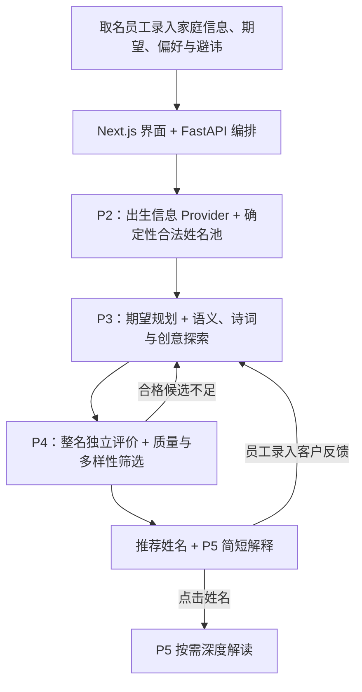

# 中文姓名生成 Agent

**用检索、LLM 整名评价与人工审核，改造传统规则取名流程。**

[English](README.md) · [简体中文](README.zh-CN.md)

> 本仓库是**项目展示页**，不公开业务源码、客户资料、密钥或可运行服务。系统供公司取名员工使用，并非家长自行操作的产品。

## 为什么做这个项目

员工原本需要了解客户要求，查字义和古诗词，再从大量排列组合中寻找合适的名字。这个过程耗时，质量也依赖个人的文字积累与审美。原有程序能够稳定执行出生信息、五行、笔画、字库和避讳规则，却无法理解“希望孩子敢探索，但内心平和”这样的开放期望，也不能判断两个寓意不错的字放在一起是否自然。

V1 希望帮助员工**更快探索庞大的合法姓名空间，找到贴近具体家庭的整名**。员工仍负责最终审核与沟通。

## 当前 V1 如何工作

**P2 先确定哪些名字可以用。** 出生信息经外部 Provider 获取并核验，确定性规则再形成当次完整合法池。模型不能修改出生事实、笔画、五行约束或避讳；任何新提议都要回到当前合法池确认。

**P3 寻找值得进一步看的名字。** LLM 将客户原话规划成多个探索方向。BM25 从姓名和字义文字里寻找明确的关键词匹配；本地 BGE 向量检索则将双字向量合成，与查询向量比较余弦相似度，补充不同措辞下的语义联系。两路各自排序、交错给探索模型，分数并不是“名字好坏总分”。系统还会查诗词、浏览检索前列以外的合法池，并提出有限的新组合；候选合并去重后再次核对合法性。

**P4 判断完整姓名是否值得推荐。** 它不把 P3 的高检索分、创意故事或诗词线索直接当成质量依据。LLM 按 Prompt 独立看姓与双字连读、谐音、搭配、整体意境、客户期望与负面联想，给自然度、契合度和审美输出 0～2 档结构化判断。程序先执行不能靠高分抵消的质量门槛，再对通过者按 `2×自然度＋2×期望契合度＋审美` 排序；没有明确期望时不计契合度。最终选择还降低重复用字和相似风格的优先级。模型给的是语言和审美判断，**不是经过人工验证的满意概率**。

**P5 解释入选姓名。** 推荐名附有简短解释；只有员工点击姓名才生成更长的个性化深度解读。诗词出处须有真实原文与经过审核的上下文，不能因字面碰巧出现就宣称“出自某诗”。

员工可录入客户反馈进入下一轮：出生及命名硬约束保持不变，软性偏好可以更新，已展示或明确不喜欢的名字不再重复推荐。P4 合格数不足时也可触发有限补探索。因此 V1 具有受限工具选择和结果反馈，属于 **Agentic Workflow**；它仍由单一服务编排，并非已部署的模块化 Multi-Agent。

## 架构是如何演进的

早期曾考虑让 LLM 预先理解所有双字组合，建立整名语义库。理论组合约百万级；用当时小样本的 Token 用量机械外推，得到约 **7.94 亿 Token** 的方案估算，**并非 V1 的实际消耗**。费用、审核与维护都不划算，因此改为离线复用字级语义资产、本地宽召回，只对少量高潜力候选做 LLM 整名判断。

检索实验也表明：字义相关不等于名字整体自然。自然的间接意境可能被低估，牵强的单字联想也可能排在前面，于是将 P3 的候选发现与 P4 的独立质量判断分开。诗词路线进一步要求姓名双字在原文中连续出现，并对最终入选名字审查语境；只有字面命中不能作为可信出处。

## 工程实现与边界

未公开的业务实现使用 **Next.js、React、TypeScript、FastAPI、Pydantic、Python、本地 BM25/BGE 检索和 DeepSeek**。原有规则由 126 组黄金基准保护；工作流还有 Python/Vitest 测试、Schema 校验、Provider 边界、有限重试、共享 Token/费用预算、版本化缓存、会话恢复与失败隔离。实现仓库已配置 Docker Compose、GitHub Actions CI 和 Windows BAT 启动方式；**本展示仓库仅有文档，不能从这里启动系统或运行这些 CI**。

本地功能及受控端到端核验能够说明流程可以运行，**不能证明推荐已达到资深员工审美水平或量化了效率提升**。检索仍可能漏掉好名字，模型的审美有主观性，外部 Provider 也会影响可用性。目前没有公开生产部署及多用户安全隔离。

## 未来方向：模块化探索（尚未实现）

计划中的 V2 将评估**诗词文化、地理文化、时代与重大事件、开放创新**四类探索模块。它们提供少量候选方向、可核实事实以及明确标为联想的意象，再统一匹配 P2 合法池，交给 P4 整名评价；可信的背景材料也可用于 P5 按需解释。地理模块要分清出生地和老家，历史事件要有来源；各模块需要独立的超时、预算、缓存与失败隔离。

这仍是**计划，不是当前 V1 功能**。是否值得升级，要看它能否以合理成本带来更多合法、自然且得到员工认可的名字，而不是看 Agent 数量。
